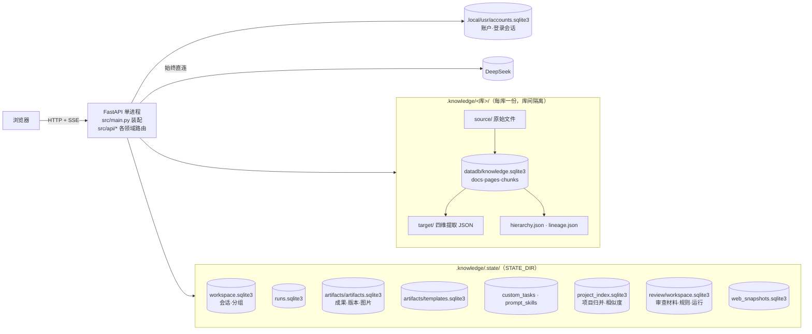
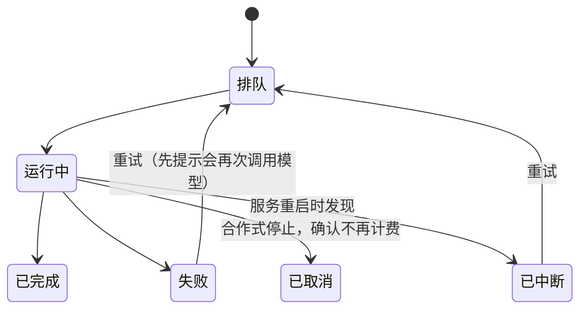

# 现行系统设计

日期：2026-10-20
来源：升级方案 D-doc 卡（02 目标设计 §1–§2）
状态：现行

- 由 [02 目标设计](../tasks/dox_agent_升级方案-20261019/02_目标设计.md) §1–§2 改写，对照提交 `db0edf1` 的代码逐项核实；界面部分见 [界面.md](界面.md)。
- 读法：每节先写**现状（实测）**，再写**目标**和负责落地的任务卡。目标是已确认的方向（D1–D5 已授权），不是已实现的事实。
- 一个事实只在一处维护：产品要求以 [PROJECT §0](../PROJECT.md#0-现行产品要求截至-query-2026-1023-1156) 为准，取舍记录在 [DECISIONS](../DECISIONS.md)，本文只写系统怎样承载它们。
- 可复核的部分有脚本：权限矩阵由 `scripts/permission_matrix.py` 实测（`check.sh quick` 每次运行）；其余数字的出处写在对应位置。

## 1. 总览



单机单进程：`launch.sh` / `launch.cmd` 启动一个 uvicorn 进程，前端为构建后的静态文件。模型调用始终直连、不经系统代理（2026-10-20，DECISIONS）。

## 2. 对象与唯一写入方

| 对象 | 身份 | 现状存储（实测） | 写入方 | 目标 | 卡 |
|---|---|---|---|---|---|
| 资料库 | `corpus_id`（目录名派生，稳定） | 库目录 + `.state/corpora.json` 登记 + `workspace.sqlite3` 中分组 | `agent/corpora.py`、`corpus_groups.py` | 不变；分组迁入 `state.sqlite3` | B3 |
| 资料 | `doc_id@version` | 每库 `knowledge.sqlite3`：`files` `docs` `doc_pages` `doc_markdown` `chunks` `meta` | `knowledge.py`、`parsers.py` | 不变（每库独立是有意设计） | — |
| 四维提取 | `doc_id` + 版本 | 每库 `target/*.json` | `targets.py` | 不变；执行接入运行服务 | B1 |
| 项目 | 批准号归并 | `project_index.sqlite3`：`project_documents`（派生缓存）`topic_merges`（人工合并，**非缓存**）`project_vectors` | `project_index.py`、`project_similarity.py` | 缓存可重建；`topic_merges` 迁入 `state.sqlite3` | B3 |
| 会话 | `session_key` | `workspace.sqlite3` `records` | `workspace.py` | 迁入 `state.sqlite3` | B3 |
| 任务定义 | `task_id@version` | `custom_tasks.sqlite3` `tasks` `versions` | `custom_tasks.py` | 迁入 `state.sqlite3` | B3 |
| 报告模板 | `template_id@version` | `artifacts/templates.sqlite3` | `custom_templates.py` | 迁入 `state.sqlite3` | B3 |
| Prompt/Skill | `asset_id@version` | `prompt_skills.sqlite3` | `prompt_skills.py` | 迁入 `state.sqlite3` | B3 |
| 执行 | `run_id` | **三处**：`runs.sqlite3`（问答、报告、情报分析）；审查 `review/workspace.sqlite3` 中 `kind=run`；导入与四维提取只在进程内存 | `runs.py`、`review/routes.py`、`main.py` | 一个 `runs` 表 + 进程内运行器（§4） | B1 |
| 成果 | `artifact_id@version` | `artifacts.sqlite3` `artifacts` `artifact_versions` `artifact_images` `artifact_inputs` `purged_artifacts` | `artifacts.py` | 迁入 `state.sqlite3`；审查报告经统一入口引用，明细仍归审查 | B3、B1 |
| 审查材料、规则、结果 | `id` | `review/workspace.sqlite3` 单表 `objects`（按 `kind` 区分 7 类） | `review/storage.py` | 保留领域明细；执行状态并入统一 `runs` | B1 |
| 网页快照 | `snapshot_id` | `web_snapshots.sqlite3` | `web_snapshots.py` | 迁入 `state.sqlite3` | B3 |
| 账户 | `username` | `.local/usr/accounts.sqlite3` `accounts` `sessions` `attempts` `guides` | `auth.py` | 迁入 `state.sqlite3`，路径进 `STATE_DIR`（D1 已授权，先副本演练） | B3 |
| 引用 | `corpus_id/doc_id@version#位置` | 写在成果版本正文与元数据中 | `artifacts.py` | 不变 | — |

规则：

- 一个对象只有一个写入方模块；别的模块通过它的公开函数读写，不直接打开它的数据库文件。
- 派生缓存（`project_documents`、`project_vectors`、`chunks`）可删除重建；人工产生的数据（`topic_merges`、会话、成果版本、审查结论）不可当缓存处理，迁移时逐条核对。
- 迁移按对象进行，同一时间只有一个写入方，不双写；被替代的表与读路径在验证后一并删除，并登记 cleanup-log。

## 3. 存储：现状 → 目标

现状是 9 个应用级 SQLite 文件加每库 1 个，跨对象没有事务。`main.py` 启动时还检查 3 个旧文件名（`artifacts.sqlite3`、`reports.sqlite3`、`custom_templates.sqlite3` 在 `.state/` 根）以提示离线迁移。

| 现状文件 | 处理 | 说明 |
|---|---|---|
| `workspace.sqlite3`、`runs.sqlite3`、`custom_tasks.sqlite3`、`prompt_skills.sqlite3`、`web_snapshots.sqlite3`、`artifacts/artifacts.sqlite3`、`artifacts/templates.sqlite3`、`.local/usr/accounts.sqlite3` | **合并**进 `STATE_DIR/state.sqlite3` | 每迁一个对象删一个旧文件；成果图片等附件仍在目录中，成组备份 |
| `project_index.sqlite3` | **拆分**：`topic_merges` 迁入 `state.sqlite3`；`project_documents`、`project_vectors` 留作可删缓存 | 缓存失效靠签名（`INDEX_VERSION` 等），删除即重建 |
| `review/workspace.sqlite3` | **保留**为审查领域库；其中 `run` 的执行状态改由统一 `runs` 持有，审查只存明细 | 先修 §6 发现 2 |
| 每库 `knowledge.sqlite3` | **保留** | 库可整体拷贝、提交到仓库，是有意的边界 |
| `.state/` 根的旧成果文件名检查、`artifact_migration.py` | 全部用户数据迁完后**删除** | 迁移器统一到 `core/db` 后不再需要单独脚本 |

迁移契约沿用 02 §1.4：停写 → SQLite 一致性备份 → 清点 → 迁移 → 按 ID、外键、版本、引用、账号登录核对（不只比条数）→ 切换；失败回滚完整备份。

**迁移机制（B3，已实现）**：`src/core/db.py`。

- `connect()`：统一超时与外键设置，`with` 结束时提交并**关闭**连接（此前 `sqlite3.connect` 只提交、不关闭）。
- `migrate(path, steps)`：按 `PRAGMA user_version` 顺序执行只增不改的结构步骤；空文件原地建表；有数据的文件先经备份 API 备份到同目录 `backups/`，再在暂存副本上迁移、通过 `integrity_check` 后一次改名替换，任何一步失败原文件不变；写 `<文件>.migration.json` 记录备份与迁移后摘要。
- `restore(path)`：仅当迁移后没有新写入时用备份回滚，否则拒绝并说明。
- 已接入：应用状态的 9 个文件与账户库，各自把原有建表语句作为第 1 步（原样采纳现有数据）；同一文件的多个模块共用一份步骤表（`workspace.sqlite3`、`project_index.sqlite3`）。每库 `knowledge.sqlite3` 随仓库提交，不接入。
- 检查：`tests/test_core_db.py`（空库→最新、旧库带数据→最新、失败不动原件、中断后可重做、回滚与新写入后拒绝回滚、版本高于程序时拒绝），随 `check.sh quick` 运行。
- 演练（2026-10-20，真实状态与账户的副本，不入库）：10 个文件 v0→v1，逐表行数与整行摘要一致，生成 10 份备份；三个账户在迁移后的副本上登录成功、错误口令被拒；未写入时回滚成功，写入后回滚被拒绝。真实文件未改动，下次启动时按同一流程自动迁移并在各目录 `backups/` 留备份。
- 日志模式暂保持默认回滚日志、不启用 WAL：其余模块仍有直接 `sqlite3.connect` 且不关闭的连接，WAL 下逐个复制 `.sqlite3` 文件的备份会漏掉尚未写回的内容（A7 恢复测试正是这样备份）。待所有连接都经 `connect()` 后再启用。

## 4. 执行：四种现状 → 一个运行服务

| 现状 | 用于 | 关页面后 | 服务重启后 | 位置 |
|---|---|---|---|---|
| ① 请求内执行 + `runs` 记录 | 问答（SSE）、报告、情报分析 | 报告：**实测关页面后继续生成并保存**（uvicorn 不因客户端断开取消处理函数，`browser_run_detach`）；问答：**由独立任务生成、页面只是跟随**（`src/answers.py`，2026-10-20 用户选择“继续生成”），关页面后照常写完，回到会话自动接上或显示完整回答；停止须点“停止”，服务端随即取消 | 未完成的报告标为“已中断，可重试”（`artifacts.INTERRUPTED`），面板可按原设置重新生成（`POST /api/artifacts/{id}/retry`），成功后旧记录移入回收站 | `api/chat.py`、`api/reports.py`、`intelligence.py` |
| ② 请求内执行、开始即建报告记录 | 周期总结（B1，2026-10-20） | 同上 | 失败写明原因；重启标“已中断” | `period_summary.py`、`api/reports.py` |
| ③ 线程池 + 审查自己的 `run` 对象 | 资料审查、元数据提取 | 继续执行 | 中断的审查需另行判断 | `review/routes.py:32`、`:626` |
| ④ ~~进程内任务，状态只在内存~~ → **持久化运行器**（`src/jobs.py`，2026-10-20） | 资料导入、四维提取 | 继续执行 | 显示“已中断”，资料库页顶部提示并可再次刷新 | `jobs.Jobs`，状态写入 `runs` |

目标（B1）：一个持久化 `runs` 表 + 进程内 worker，前端经 SSE 订阅、断线可重订；状态统一为下图。导入时先持久化运行与冻结输入，再交给 worker；同一输入重复提交复用或明确拒绝。



接入顺序：先报告与审查（G2-3 的“关页面再回来”），再问答、情报分析、周期总结，最后导入与四维提取。

2026-10-20 第一批：G2-3 对报告已经满足并有冒烟脚本（`tests/browser_run_detach.py`：提交 → 关页面 → 回来已完成；`kill -9` 重启 → “已中断，可重试” → 重试完成）。

第三批（问答）：回答写入运行的事件日志，`POST /api/chat` 与 `GET /api/runs/{id}/events` 都只是跟随者；完成后把事件（token 合并）存入运行记录的 `replay`，内存日志 10 分钟后释放；`POST /api/runs/{id}/cancel` 显式停止；重启时未完成的问答记为已中断；发送时立即保存会话，避免刚发送就关页面丢失问题。代价：离开页面后模型仍按完整回答计费（用户已接受）。

第二批：`src/jobs.py` 运行器——运行先写入 `runs` 再开始，进度随做随写，关页面不影响，停机记为已中断，启动时把上个进程遗留的“运行中”改为“已中断”。资料导入与四维提取已改由它执行，原来的内存字典（`corpus_jobs/corpus_tasks/target_jobs/target_tasks`）已删除；接口返回的进度结构不变，另带 `run_id`、`ended_at`。冒烟脚本同样以 `kill -9` 验证导入中断。`runs.sqlite3` 借此做了迁移器的第一次真实升级（v2：按类型与状态的索引）。接口目标为 `POST /api/tasks/{type}/runs`、`GET /api/runs/{id}`、`GET /api/runs/{id}/events`（SSE）；现有 `/api/reports`、`/api/intelligence/analyze`、`/api/summaries`、`/api/review/runs` 在各自迁移完成后删除，不保留兼容层。

## 5. 权限矩阵（实测）

能力与角色（PROJECT §0；用户 = 普通用户，领导 = owner，管理员 = admin）：

| 能力 | 用户 | 领导 | 管理员 |
|---|---|---|---|
| 本人登录、口令、操作指南 | ✓ | ✓ | ✓ |
| 个人资料库（本人新建、改名、增删引用、删除；只有本人可见）| ✓ | ✓ | ✓ |
| 主题综合（分析，生成并保存于资料库） | ✓ | ✓ | ✓ |
| 系统资料库与资料维护（新建、分组、改名、说明、删除，文件增删改与导入，网页加入资料库）（D-20261027-1） | — | — | ✓ |
| 对话、会话、报告、成果与导出、报告模板、情报分析、网页资料、审查执行与材料 | ✓ | ✓ | ✓ |
| 删除报告（移入回收站、彻底删除） | 作者 | 作者 | ✓（含未记录作者的早期报告） |
| 从回收站还原 | ✓ | ✓ | ✓ |
| 资料库结构重新生成（四维提取、主题合并、谱系、层级）与目录重新关联 | — | — | ✓ |
| 共享分析任务与 Prompt/Skill | — | — | ✓ |
| 审查模版：共享模版的修改与删除、设为全员默认（应用）（D-20261028-1） | — | — | ✓ |
| 审查模版：个人模版（新建、上传规范生成、修改、删除，仅本人可见；共享模版可复制） | ✓ | ✓ | ✓ |
| 账户管理 | — | — | ✓ |
| 数据可见范围 | 全员共享（G3 前重新确认） | 同左 | 同左 |

**实测方法**：`scripts/permission_matrix.py` 从 OpenAPI 取出全部写接口，在临时状态目录中以三种角色各调用一次（空请求体），401/403 记为拒绝，其余记为通过授权；处理函数内部的管理员检查（如账户管理）按源码补记。运行时屏蔽一切非本机网络、模型配置指向占位地址，不会调用真实模型。每个接口必须归入上表一项能力，否则失败。

**结果（2026-10-20）**：79 个写接口（含报告重新生成），与矩阵一致 79 个。完整清单用 `--markdown` 生成，不抄进本文以免漂移。

2026-10-27（D-20261027-1）：系统资料库写接口改为 `ADMIN_ONLY`，网页确认加入资料库在处理函数中判断管理员；新增个人资料库接口 `/api/personal-libraries`（按账户隔离）。实测 86 个写接口与矩阵一致。

实现（B2，2026-10-20）：管理员专属的写接口在路由上声明 `dependencies=ADMIN_ONLY`（`auth.require_admin`），中间件只负责登录与来源校验，原路径正则 `ADMIN_WRITES` 已删除；账户接口仍在函数内 `admin(request)`。本脚本实测 80 个写接口与矩阵一致，作为回归检查保留。

2026-10-20 用户决定：删除报告限作者或管理员（按记录的生成人判断，角色探针只测到“可调用”，记录级规则由 `tests/test_app.py::test_only_the_author_or_an_administrator_may_delete_a_report` 覆盖）；模型连接测试所有账户都可使用。

## 6. 结构性发现（D-doc 核对代码时发现）

| # | 发现 | 影响 | 处理 |
|---|---|---|---|
| 1 | 审查的模型配置（`review/model_client.py` `config()`）不读应用创建时传入的 Settings，而是重新读取项目 `.env` | 用隔离配置创建的应用（测试、检查脚本）在审查路径上仍会拿到真实密钥；权限探针第一次运行时即触发了真实模型请求（因本机网络不通而失败，未产生费用） | 探针已屏蔽网络并覆盖模型配置；根治并入 B2：审查模块从应用状态取 Settings |
| 2 | 审查存储目录 `DATA` 在导入时有一个指向真实 `.knowledge/.state/review/` 的默认值；应用启动时 `init_storage` 会按自身状态目录重设（`main.py:545`），但在应用启动之外使用审查存储的代码会写到真实目录 | 风险限于不经应用启动的脚本与测试；已核对真实审查库最后写入为 10-16 | **已修（B3）**：删除默认值，未初始化时直接报错 |
| 3 | 导入与四维提取的进度只在内存（§4 ④） | 服务重启后看不到中断的导入 | **已修（B1 第二批）**：改由持久化运行器执行 |
| 4 | 报告、情报分析、周期总结在请求内执行（§4 ①②） | 实测报告在关页面后仍完成；服务重启才会中断 | 报告已可识别中断并重试（B1 第一批）；统一运行器仍在 B1 |
| 5 | 项目索引库里人工的 `topic_merges` 与可删缓存同在一个文件 | 误把整个文件当缓存删除会丢失人工合并 | B3 拆分（§3） |

## 7. 工作上下文

```
WorkContext = { browsing_corpus, scope: { corpus_ids, doc_ids@version, source: "auto" | "manual" }, task_type, question, template_version }
```

- 现状：浏览的库、分析范围、任务分散在 `store.tsx`（1375 行，36 个组件使用）、URL 参数和 localStorage 中；分析工作区（`AnalysisWorkspace`）已经做到“同一范围内问答、对比、保存、生成报告”。
- 目标：`browsing_corpus` 与 `scope` 在类型上分开；入口只预填（资料列表选中 → 范围；存量分析卡片 → 任务；对话 → 系统推荐范围），提交都走同一个运行接口；已提交运行的上下文存在服务端 `runs`，刷新或换设备可恢复。界面布局状态只留在浏览器本地。前端拆分见 [界面.md](界面.md) §6。

## 8. 统计契约

- 唯一来源：`GET /api/overview/libraries`。每库返回项目数（库内按批准号去重）、立项年份、各年项目数，以及**一种**经费口径的合计、覆盖项目数和逐年金额。
- 经费口径：三种口径（批准资助金额、直接费用、总经费）分开计算，接口在所有库中统一取给出金额项目最多的一种，并返回口径名（`funding.scope`、`funding.label`）；档案字段“资助金额”无单位，按万元计（2026-10-20，DECISIONS）。缺失不补零，冲突不计入。
- 跨库合计不去重，界面须注明。年度图固定最近十年，范围外不画。
- 新的统计需求先扩展这个接口，不另建同义接口。

## 9. 运行与检查

| 事项 | 现行做法 |
|---|---|
| 启动 | `launch.sh` / `launch.cmd`：按需构建前端、检查端口、启动、打开浏览器；模型检查直连，失败时识别代理软件 fake-ip DNS 并给出处理办法 |
| 模型 | 单一配置（`MODEL_*`，审查可用 `REVIEW_MODEL_*` 覆盖）；始终直连 |
| 检查 | `scripts/check.sh quick`（ruff、pytest、权限矩阵、前端测试、tsc）/ `full`（+ 构建、8 项浏览器冒烟）/ `all`（+ 其余 12 项浏览器旅程） |
| 测试纪律 | 不调用真实模型、不写真实资料；浏览器脚本用临时状态目录与替身模型 |
