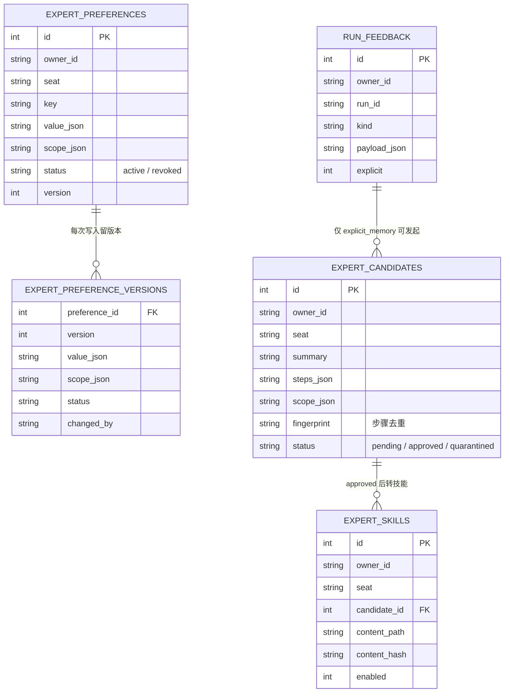
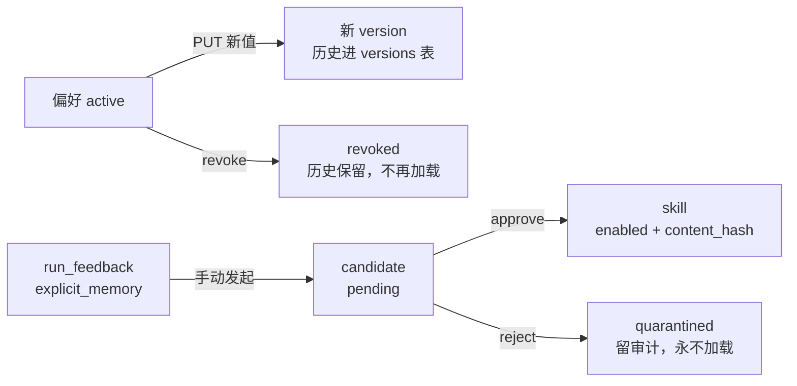
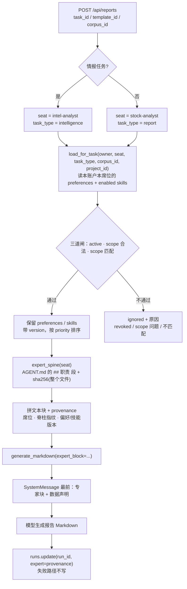

# 专家系统后端 Pipeline（现状）

- 状态：参考稿（按当前工作区代码绘制，不是目标设计）
- 日期：2026-11-06
- 来源：`src/experts.py`、`src/api/experts.py`、`src/api/reports.py`、`src/reports.py`、`state.db`
- 渲染版：`E:\local_db\.knowledge\HermesBot\notes\专家系统后端pipeline-20261106.html`

## 1. 存储模型

## 2. 写入与沉淀

## 3. 运行时读取 → 注入 → 溯源

## 现状断点

1. **只有两席接入**：`project-application`、`corpus-ingest` 从未调用 `load_for_task`；只有报告生成的 `intel-analyst` / `stock-analyst`。
2. **没有初始专家**：新账户四席全空，只有 `AGENT.md` 脊柱；管理员看不到可用样例。
3. **定义门槛高**：偏好需要 `key + JSON value + scope + evidence`；技能需要反馈→候选→批准→建技能四步。
4. **前端只做 CRUD**：`/experts` 只有席位与计数，没有「何时生效、最近用了哪版、为什么没加载」。
5. **沉淀靠手动**：候选只能由 `explicit_memory` 手动发起，没有自动归纳。
6. **scope 是硬门槛**：`_matches` 要求 `task_type` 必填且精确匹配；空 scope 直接拒绝，界面不提示。

一句话：后端是「版本化偏好 + 审批式技能 + 严格 scope 匹配」的专家参数层，但只接了报告生成的两席，没有初始内容、生效反馈与自动沉淀，所以前台像一张孤立设置页。
